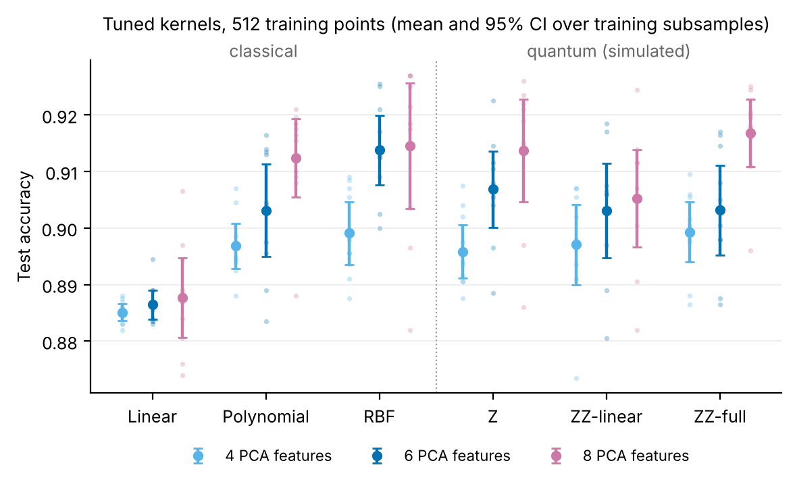
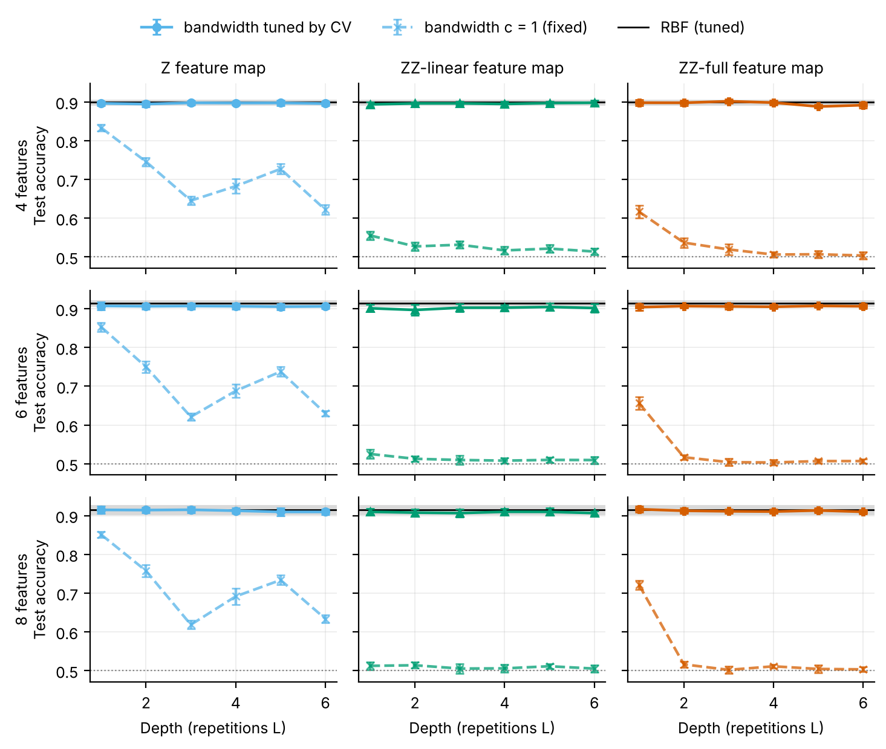
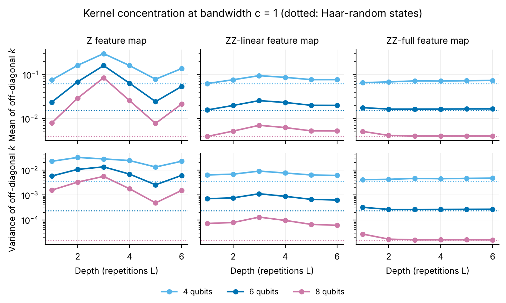
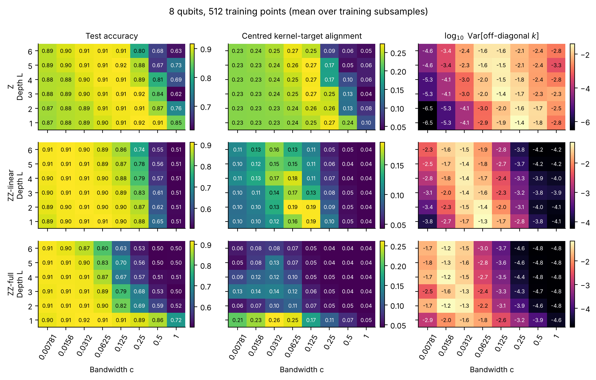
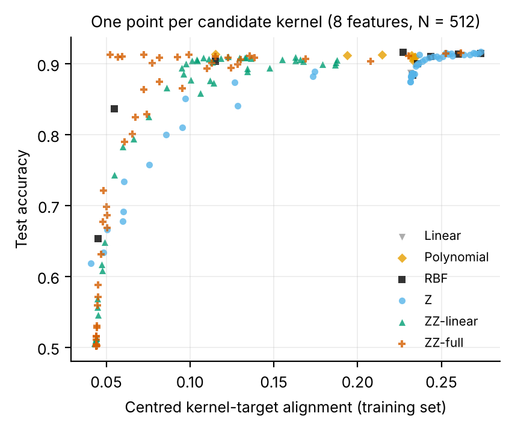
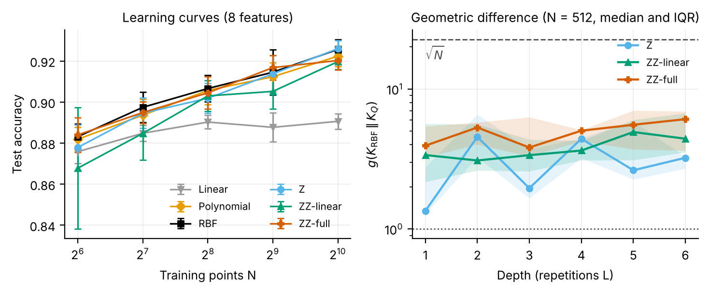
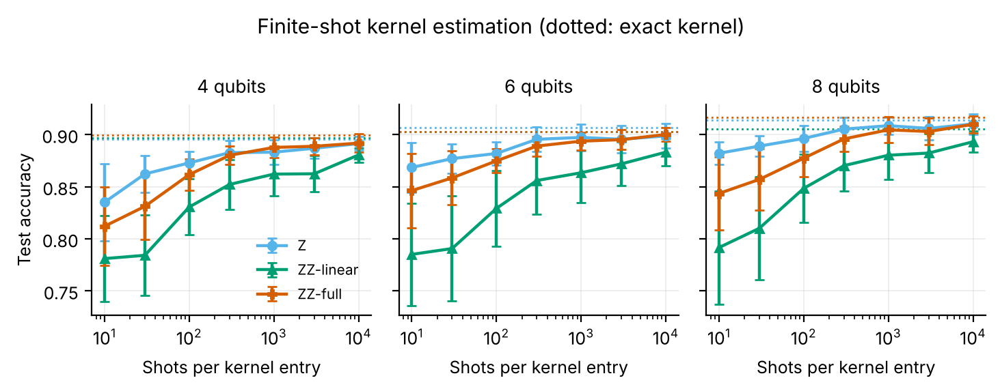

# Classical vs. quantum kernel SVMs: a controlled comparison

Support vector machines with classical kernels (linear, polynomial, RBF) and with
quantum fidelity kernels (Z and ZZ feature maps, depth 1 to 6) are trained on the same
real data with the same model-selection procedure. The study asks three questions:

1. Once every kernel is tuned equally carefully, does a quantum feature map classify
   better than an RBF kernel?
2. What happens to a quantum kernel as its feature map gets deeper, and why?
3. Which label-free and label-aware diagnostics of the Gram matrix (alignment,
   concentration, geometric difference) explain the accuracies that are observed?

**Findings** (10 training subsamples per configuration, exact statevector simulation):

- **No quantum advantage, and no quantum penalty once the bandwidth is tuned.** With
  512 training points every tuned quantum kernel is within 1.1 percentage points of
  the RBF kernel (e.g. ZZ-full 91.7% vs. RBF 91.5% at 8 features). In none of the nine
  quantum-vs-RBF comparisons is the quantum kernel better beyond noise; in five it is
  worse with a 95% interval that excludes zero. The RBF kernel beats the linear one by
  1.4 to 2.7 points on every seed, so the task does discriminate between kernels.
- **The standard, untuned encoding fails, and fails faster with depth.** At bandwidth
  $c = 1$ the fully entangled ZZ map drops from 72% (depth 1) to 50–52% (depth ≥ 2) on
  8 qubits. Its kernel values reach the Haar-random moments by depth 3: the Gram
  matrix is nearly the identity, the SVM memorises (100% training accuracy, every
  point a support vector) and cannot generalise.
- **Depth neither helps nor hurts once the bandwidth is tuned.** With $c$ chosen by
  cross-validation, mean accuracy varies by at most 0.7 points between depth 1 and 6
  for each of the three feature maps on 8 qubits (1.4 points over all dimensions).
- **Alignment ranks kernels within a family but not across families.** Spearman
  correlation with test accuracy is 0.78 to 0.97 inside each quantum family, yet
  ZZ kernels with alignment below 0.1 match RBF kernels with alignment 0.25.
- **The geometric difference to the RBF kernel is small** (median 2 to 6, against
  $\sqrt{N} \approx 22.6$), which is the regime where Huang et al. predict that
  classical kernels remain competitive.



## Setup

**Data.** Fashion-MNIST (Xiao et al., 2017), classes *Dress* vs. *Shirt* — the binary
task used by Huang et al. (2021), which makes the numbers comparable with a published
quantum-kernel benchmark. Training sets are class-balanced random subsamples of the
official training split (N = 512 for the main study, N = 64 to 1024 for learning
curves), redrawn for each of 10 seeds. The test set is always the full 2 000 images of
the two classes in the official test split and is never used for fitting or selection.

**Preprocessing.** PCA to *d* ∈ {4, 6, 8} components followed by per-component
standardisation, both fitted on the training subsample only. One qubit encodes one
component, so the quantum models use 4 to 8 qubits.

**Kernels.**

| Family | Definition | Tuned hyper-parameters |
|:--|:--|:--|
| Linear | $x^\top x'$ | – |
| Polynomial | $(\gamma x^\top x' + 1)^p$ | degree $p$ = 2 or 3, 4 values of $\gamma$ |
| RBF | $\exp(-\gamma \lVert x - x' \rVert^2)$ | 9 values of $\gamma$ from $10^{-3}$ to $10$ |
| Z | $\lvert\langle \phi(cx) \vert \phi(cx') \rangle\rvert^2$, no entangling gates | depth $L$ = 1 to 6, 8 bandwidths $c$ from $2^{-7}$ to $1$ |
| ZZ-linear | same, nearest-neighbour ZZ couplings | as above |
| ZZ-full | same, all-pairs ZZ couplings | as above |

The quantum feature maps are those of Havlíček et al. (2019), identical to Qiskit's
`z_feature_map` / `zz_feature_map`:
$\vert\phi(x)\rangle = [D(x) H^{\otimes n}]^{L} \vert 0\rangle^{\otimes n}$, where $D(x)$
applies the phases $2x_i$ on single qubits and $2(\pi - x_i)(\pi - x_j)$ on entangled
pairs. One repetition of the nearest-neighbour map on three qubits:

```text
   ┌───┐┌───────────┐
0: ┤ H ├┤ P(2*x[0]) ├──■────────────────────────────────────■────────────────────────────────────────────
   ├───┤├───────────┤┌─┴─┐┌──────────────────────────────┐┌─┴─┐
1: ┤ H ├┤ P(2*x[1]) ├┤ X ├┤ P((-π + x[0])*(-π + x[1])*2) ├┤ X ├──■────────────────────────────────────■──
   ├───┤├───────────┤└───┘└──────────────────────────────┘└───┘┌─┴─┐┌──────────────────────────────┐┌─┴─┐
2: ┤ H ├┤ P(2*x[2]) ├──────────────────────────────────────────┤ X ├┤ P((-π + x[1])*(-π + x[2])*2) ├┤ X ├
   └───┘└───────────┘                                          └───┘└──────────────────────────────┘└───┘
```

The bandwidth $c$ rescales the inputs before encoding. Treating it as a
hyper-parameter (Shaydulin & Wild, 2022; Canatar et al., 2023) is the quantum
counterpart of tuning the RBF $\gamma$; $c = 1$ is the encoding one gets by feeding
standardised features directly into the circuit.

**Model selection.** Identical for every kernel. The SVM is always fitted on a
precomputed Gram matrix, so the optimiser and the selection code are shared and the
kernel function is the only thing that changes. For each candidate kernel, $C$ is
chosen from five values between $10^{-2}$ and $10^{2}$ by stratified 5-fold
cross-validation on the training set; within a family, the candidate with the best
cross-validation accuracy is selected; only that model's test accuracy is reported as
the family's result. Test
accuracy of the other candidates is stored for sensitivity plots but never used to
choose anything (this is covered by a unit test).

**Diagnostics**, all computed on the training Gram matrix:

- *Centred kernel-target alignment* (Cristianini et al., 2001; Cortes et al., 2012).
- *Concentration*: mean and variance of the off-diagonal kernel entries, compared with
  the exact moments for Haar-random states (Thanasilp et al., 2024).
- *Geometric difference* $g(K_\mathrm{RBF} \Vert K_Q)$ and *model complexity* $s_K$
  (Huang et al., 2021).
- *Finite-shot estimation*: kernel entries resampled from the binomial distribution of
  the compute-uncompute circuit, with $C$ re-tuned on the noisy matrix.

## Results

All numbers below are generated by `scripts/make_figures.py` and collected in
[`results/summary.md`](results/summary.md).

### 1. Tuned quantum kernels match the RBF kernel but do not beat it

Test accuracy in % (mean ± standard deviation over 10 training subsamples, N = 512):

| Kernel | 4 features | 6 features | 8 features |
|:--|:--|:--|:--|
| Linear | 88.5 ± 0.2 | 88.6 ± 0.4 | 88.8 ± 1.0 |
| Polynomial | 89.7 ± 0.6 | 90.3 ± 1.1 | 91.2 ± 1.0 |
| RBF | 89.9 ± 0.8 | 91.4 ± 0.9 | 91.5 ± 1.5 |
| Z | 89.6 ± 0.7 | 90.7 ± 0.9 | 91.4 ± 1.3 |
| ZZ-linear | 89.7 ± 1.0 | 90.3 ± 1.2 | 90.5 ± 1.2 |
| ZZ-full | 89.9 ± 0.7 | 90.3 ± 1.1 | 91.7 ± 0.8 |

Seed-to-seed variation is common to all kernels, so the informative comparison is the
paired difference to the RBF kernel on the same training subsample (percentage
points, mean ± 95% CI half-width; seeds won / lost in brackets):

| Kernel | 4 features | 6 features | 8 features |
|:--|:--|:--|:--|
| Linear | −1.40 ± 0.50 (0/10) | −2.74 ± 0.53 (0/10) | −2.69 ± 1.16 (0/10) |
| Polynomial | −0.22 ± 0.38 (5/5) | −1.07 ± 0.57 (0/10) | −0.22 ± 0.75 (3/6) |
| Z | −0.33 ± 0.25 (1/8) | −0.70 ± 0.53 (1/9) | −0.08 ± 0.70 (3/7) |
| ZZ-linear | −0.20 ± 0.50 (4/6) | −1.08 ± 0.60 (0/10) | −0.94 ± 0.64 (1/8) |
| ZZ-full | +0.02 ± 0.50 (6/4) | −1.07 ± 0.47 (0/10) | +0.23 ± 0.78 (5/5) |

The task does separate kernels — the linear kernel loses on every seed — but it does
not separate quantum from classical ones. The same holds along the learning curve at
8 features (figure in section 5): from N = 64 to N = 1024 the gap between the linear
and RBF kernels grows from 0.7 to 3.5 points, while the ZZ-full kernel stays within
0.6 points of RBF throughout and is 0.5 ± 0.5 points behind at N = 1024.

Note that a quantum family selects over depth as well as bandwidth (48 candidates
against 9 for RBF), so the protocol gives the quantum kernels the larger tuning
budget.

### 2. Without bandwidth tuning, accuracy collapses with depth



Dashed lines use the encoding at face value ($c = 1$). On 8 qubits (N = 512):

| Feature map | L = 1 | L = 2 | L = 3 | L = 4 | L = 5 | L = 6 |
|:--|--:|--:|--:|--:|--:|--:|
| Z, $c = 1$ | 85.1 | 75.7 | 61.8 | 69.1 | 73.4 | 63.3 |
| ZZ-linear, $c = 1$ | 51.2 | 51.4 | 50.5 | 50.6 | 51.1 | 50.5 |
| ZZ-full, $c = 1$ | 72.1 | 51.6 | 50.2 | 51.1 | 50.4 | 50.3 |
| Z, tuned $c$ | 91.5 | 91.4 | 91.5 | 91.2 | 90.9 | 90.9 |
| ZZ-linear, tuned $c$ | 91.0 | 90.8 | 90.6 | 91.0 | 91.0 | 90.6 |
| ZZ-full, tuned $c$ | 91.6 | 91.2 | 91.1 | 91.0 | 91.3 | 91.0 |

The mechanism is visible in the Gram matrix itself. For two Haar-random states on
$n$ qubits the fidelity has mean $2^{-n}$ and variance
$(2^n - 1)/(4^n (2^n + 1))$. At $c = 1$ the ZZ-full kernel reaches both values almost
exactly: on 8 qubits the off-diagonal mean is 0.0040 (Haar: 0.0039) and the variance
is within 6% of the Haar value from depth 3 onwards. The feature map sends every pair
of distinct images to nearly orthogonal states, $K \approx I$, and the SVM can only
memorise: training accuracy is 100% with all 512 points as support vectors, test
accuracy is 50.3%.



Two remarks on interpretation. First, at 8 qubits a kernel value of $2^{-8}$ is still
easy to resolve, so what fails here is generalisation (a flat kernel spectrum), not
estimation; the exponential shot cost of concentration (Thanasilp et al., 2024) only
adds to it at larger sizes. Second, the Z map has no entangling gates and its kernel
is a product of single-qubit terms, so it never approaches the Haar moments (its
variance stays 30 to 370 times above the Haar value on 8 qubits). Its accuracy at
$c = 1$ still degrades, non-monotonically; repeating the encoding adds
higher-frequency components in $x$ to each single-qubit factor, which is the likely
cause, but this was not isolated here.

### 3. Bandwidth, not depth, is the hyper-parameter that matters

With the bandwidth tuned (solid lines above), the spread of mean accuracy across
depths is 0.3 to 0.7 points on 8 qubits and at most 1.4 points (ZZ-full, 4 qubits)
over all dimensions, with no consistent trend in depth.



Accuracy collapses on the large-bandwidth side, where the off-diagonal variance falls
towards the Haar value, and the more entangling the map and the deeper the circuit,
the smaller the bandwidth at which this happens (the cross-validated median is
$c = 0.125$ for Z and $c = 0.031$ for both ZZ maps). On the small-bandwidth side the
kernel becomes nearly constant and accuracy decays slowly towards that of the linear
kernel (87 to 89% for the Z map at the smallest bandwidth). The selected quantum
kernels have off-diagonal mean ≈ 0.5 and variance 0.025 to 0.04, statistics similar
to those of the selected RBF kernel (variance ≈ 0.024). In other words, tuning makes
the quantum kernels work by pulling them out of the highly expressive regime and into
one where they behave like a smooth, low-frequency classical kernel — the trade-off
analysed by Canatar et al. (2023).

### 4. Kernel-target alignment predicts accuracy within a family only



Across the 162 candidate kernels at 8 features, the Spearman correlation between
centred alignment and test accuracy is 0.77. Inside each quantum family it is 0.97
(Z), 0.78 (ZZ-linear) and 0.85 (ZZ-full): alignment is a cheap and useful proxy for
choosing a bandwidth. Across families it is not comparable. The upper-left of the
plot contains ZZ kernels with alignment 0.05 to 0.13 that reach 91%, the same as RBF
kernels with alignment 0.23 to 0.27; and among the 8 polynomial candidates the
correlation is negative (−0.74). Low alignment therefore does not imply a poor SVM:
alignment measures agreement with the single direction $yy^\top$, while the SVM is
free to weight directions that carry little of the kernel's total variance.

A practical detail: the alignment of concentrated kernels does not go to zero but to
$1/\sqrt{N-1}$ (0.044 for N = 512), the centred alignment of the identity matrix.

### 5. Geometric difference: little room for an advantage



Huang et al. (2021) bound the model complexities of two kernels on any labelling by
$s_C \le g(K_C \Vert K_Q)^2 s_Q$: if $g$ is small compared with $\sqrt{N}$ the
classical kernel is guaranteed to predict comparably, and $g \sim \sqrt{N}$ is
necessary for a quantum prediction advantage. For the cross-validated kernels at
N = 512 ($\sqrt{N} \approx 22.6$) the median over seeds and depths is 2.1 to 5.8,
depending on family, dimension and ridge parameter $\lambda$ (the figure shows
$\lambda = 10^{-2}$ at 8 features).
Values above $\sqrt{N}$ occur only in individual configurations and only for the
smaller ridge values (maximum 63.9 at $\lambda = 10^{-3}$, 26.5 at
$\lambda = 10^{-2}$, 10.3 at $\lambda = 10^{-1}$), so they depend strongly on the
regularisation. The measured accuracies are consistent with the prediction that the
RBF kernel is hard to beat on this data.

### 6. Finite-shot estimation



On hardware each kernel entry is estimated from a finite number of measurements. With
1 000 shots per entry the selected Z and ZZ-full kernels lose 0.5 to 1.3 points and
the ZZ-linear kernel 2.5 to 4.0; with 10 000 shots the losses are 0.3 to 0.8 and 1.2
to 2.0 points respectively. For scale, the N = 512 training matrix alone has 130 816
distinct entries. ZZ-linear is also the family most often selected with the largest
$C$ (50% of seeds); large dual coefficients amplify estimation noise in the decision
function, which would explain its sensitivity, but this was not tested in isolation.
The noise model contains sampling error only — no gate or readout errors.

### Robustness checks

`scripts/sanity_checks.py` ([`results/sanity_checks.md`](results/sanity_checks.md)):

- **Independent RBF baseline.** A scikit-learn `Pipeline` (PCA → scaling → `SVC`)
  tuned by `GridSearchCV`, with the preprocessing refitted inside every fold, gives
  89.8 / 90.9 / 91.6% at 4 / 6 / 8 features against 89.9 / 91.4 / 91.5% here; the
  paired differences (+0.08 ± 0.70, +0.46 ± 0.72, −0.19 ± 0.59 points) are within
  noise. The classical baseline is not weakened by this code base, and fitting PCA
  once per training subsample rather than per fold does not change the picture.
- **Width of the C grid.** 37% (Z) and 50% (ZZ-linear) of the selected quantum models
  sit at the largest $C$. Re-tuning $C$ for every selected kernel on a grid extended
  by two decades (to $10^4$) changes the quantum, RBF and polynomial results by at
  most 0.01 points: cross-validation never prefers the larger values for those
  kernels. (The check re-tunes $C$ for the already selected kernel; it does not
  repeat the search over bandwidth with the wider grid.)

## Limitations

- **Scale.** 4 to 8 qubits, simulated exactly and without hardware noise. For
  expressive feature maps concentration grows exponentially with qubit number, so
  these results are an optimistic bound on what the same maps would do on a device.
- **One task.** A single binary problem on classical image data, after a PCA that
  keeps 60% (4 features) to 69% (8 features) of the pixel variance. Nothing here
  speaks to data with structure a quantum feature map is designed to exploit; provable
  separations exist for such problems (Liu et al., 2021).
- **Kernel families.** Only fidelity kernels of fixed Pauli-Z feature maps. Projected
  quantum kernels (Huang et al., 2021) and trained embeddings are not covered.
- **Statistics.** Intervals describe variation over 10 training subsamples with a
  fixed test set; p-values in `results/summary.md` are not corrected for multiple
  comparisons. Differences of a few tenths of a point should not be over-read.
- **Grids.** Hyper-parameter grids are finite; see the robustness check above.

## Next steps

- Projected quantum kernels, which Huang et al. (2021) introduce to obtain a larger
  geometric difference than the fidelity kernel provides.
- Labels engineered to maximise the geometric difference (Huang et al., 2021), to
  check that the pipeline can detect an advantage when one is built in.
- Device noise models and error mitigation for the finite-shot experiment.
- More qubits, with a tensor-network simulator, to follow concentration as a function
  of width at fixed depth.

## Reproducing the results

```bash
git clone <repository-url> && cd <repository-name>
python -m venv .venv && source .venv/bin/activate
pip install -e ".[dev]"

pytest                               # unit tests, about 10 s
python scripts/run_experiments.py    # downloads Fashion-MNIST (30 MB), then ~40 min on 2 cores
python scripts/make_figures.py       # figures/*.png and results/summary.md
python scripts/sanity_checks.py      # robustness checks, about 10 min
```

`python scripts/run_experiments.py --quick` runs a two-seed, reduced-grid version in
under a minute. The dataset files are verified against pinned SHA-256 digests. All
randomness (subsampling, cross-validation folds, shot noise) is derived from the seed
of each configuration, so the tables in `results/` are reproduced to their stored
precision with the package versions recorded in `results/metadata.json`.

## Repository layout

```text
src/qksvm/
    data.py             Fashion-MNIST download + checksum, binary task, PCA/standardisation
    feature_maps.py     batched exact simulation of Z / ZZ feature maps
    kernels.py          classical and quantum kernels behind one interface; shot noise
    metrics.py          alignment, geometric difference, model complexity, concentration
    model_selection.py  cross-validation on precomputed Gram matrices
    experiments.py      grids and the per-configuration runner
    analysis.py         model selection from result tables, confidence intervals
scripts/
    run_experiments.py  runs all configurations in parallel, with a resumable cache
    make_figures.py     builds every figure and table from results/*.csv
    sanity_checks.py    independent scikit-learn baseline and extended C grid
tests/                  unit tests, including cross-checks against Qiskit
results/                raw result tables (CSV), summary tables, run metadata
figures/                figures used in this README
```

## Implementation notes

**Simulator.** For these feature maps $D(x)$ is diagonal in the computational basis,
so one repetition is a Walsh-Hadamard transform followed by an element-wise phase.
`feature_maps.py` applies this to all data points at once with NumPy instead of
building one circuit per point, which is what makes evaluating about 11 000 kernels
(162 candidates × 70 configurations) with cross-validation affordable on a laptop. The
simulator is not trusted on its own: the tests compare it amplitude by amplitude with
Qiskit's `zz_feature_map` circuits, compare the Gram matrices with
`qiskit_machine_learning.kernels.FidelityStatevectorKernel`, check the depth-1 Z
kernel against its closed form $\prod_i \cos^2(c (x_i - x'_i))$, and check the
binomial shot-noise model against Qiskit's sampler on the compute-uncompute circuit.

**Statistics.** Reported uncertainties are over training subsamples (seeds). Because
all kernels share each subsample and the test set, comparisons are made on paired
per-seed differences. The test set is fixed, so its own sampling error (a standard
error of about 0.7 percentage points for 2 000 images at 90% accuracy) is common to
all kernels and is not part of the intervals.

## References

- V. Havlíček et al., "Supervised learning with quantum-enhanced feature spaces",
  *Nature* **567**, 209 (2019).
- M. Schuld and N. Killoran, "Quantum machine learning in feature Hilbert spaces",
  *Phys. Rev. Lett.* **122**, 040504 (2019).
- H.-Y. Huang et al., "Power of data in quantum machine learning",
  *Nat. Commun.* **12**, 2631 (2021).
- J. Kübler, S. Buchholz and B. Schölkopf, "The inductive bias of quantum kernels",
  *NeurIPS* (2021).
- R. Shaydulin and S. M. Wild, "Importance of kernel bandwidth in quantum machine
  learning", *Phys. Rev. A* **106**, 042407 (2022).
- A. Canatar, E. Peters, C. Pehlevan, S. M. Wild and R. Shaydulin, "Bandwidth enables
  generalization in quantum kernel models", *TMLR* (2023).
- S. Thanasilp, S. Wang, M. Cerezo and Z. Holmes, "Exponential concentration in
  quantum kernel methods", *Nat. Commun.* **15**, 5200 (2024).
- N. Cristianini, J. Shawe-Taylor, A. Elisseeff and J. Kandola, "On kernel-target
  alignment", *NeurIPS* (2001).
- C. Cortes, M. Mohri and A. Rostamizadeh, "Algorithms for learning kernels based on
  centered alignment", *JMLR* **13**, 795 (2012).
- Y. Liu, S. Arunachalam and K. Temme, "A rigorous and robust quantum speed-up in
  supervised machine learning", *Nat. Phys.* **17**, 1013 (2021).
- H. Xiao, K. Rasul and R. Vollgraf, "Fashion-MNIST: a novel image dataset for
  benchmarking machine learning algorithms", arXiv:1708.07747 (2017).

## License

Code: MIT (see `LICENSE`). Fashion-MNIST is distributed by Zalando Research under the
MIT license and is downloaded at run time rather than redistributed here.
